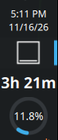

# Screentime-applet

A KDE Plasma 6 panel widget that tracks how long you spend in each application today and shows a per-app breakdown.

## Screenshots



*Compact view: total active time for today, shown in the panel.*


*Expanded view: per-app time with usage bars. Click a browser to see time per page title. Lists top 10 tabs for the browser.*

## Features

- Total active time for the day shown in the panel
- Per-application breakdown with percentages and usage bars
- Browser windows can be expanded to show time per page title
- Steam games running under Proton, including non-Steam shortcuts, are
  recognised by name
- Pause and reset buttons
- Resets automatically at midnight

## Requirements

- KDE Plasma 6
- `kpackagetool6` (ships with Plasma)

## Installation

- From the project directory:

```sh
        kpackagetool6 --type Plasma/Applet --install .
```

- To update after changes:

```sh
        kpackagetool6 --type Plasma/Applet --upgrade .
```

- Then right-click the panel, choose **Add Widgets**, and search for "Screen Time". If it doesn't appear, restart the shell:

```sh
        systemctl --user restart plasma-plasmashell
```

- For a sanity check once its on and about, run
```sh
        kpackagetool6 -t Plasma/Applet -l
```
        And check if ScreenTime is listed there.

## Limitations

- Time keeps counting while the screen is locked or you're away, as long as a
  window stays active
- Steam game names come from the install folder, not the store title


## Planned
- Implement per-document time breakdown for Calibre’s E-book Viewer and Okular, using the same expandable row as browsers
