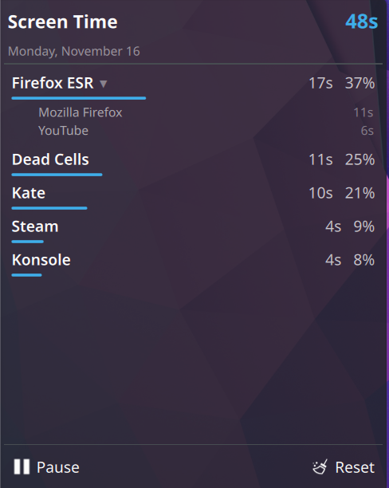

# ScreenTime

A KDE Plasma 6 panel widget that tracks how long you spend in each application today and shows a per-app breakdown.

## Screenshots


*Compact view: total active time for today, shown in the panel.*



*Expanded view: per-app time with usage bars. Click a browser to see time per page title. Lists top 10 (Default) tabs for the browser.*

## Features

- Total active time for the day shown in the panel
- Per-application breakdown with percentages and usage bars
- Browser windows can be expanded to show time per page title
- Steam games running under Proton, including non-Steam shortcuts, are
  recognised by name
- Pause and reset buttons
- Resets automatically at midnight

## Requirements

- KDE Plasma 6 with Wayland.
- `kpackagetool6` (ships with Plasma)

## Installation

1. From the project directory:

```sh
kpackagetool6 --type Plasma/Applet --install .
```

2. Then right-click the panel, choose **Add Widgets**, and search for "Screen Time". If it doesn't appear, restart the shell:

```sh
systemctl --user restart plasma-plasmashell
```

3. As a sanity check once the widget has loaded, run
```sh
kpackagetool6 --type Plasma/Applet --list
```

And check if `io.github.i-9028.screentime` is listed there. The listed name should be the same as the `Id` entry listed in [metadata.json](metadata.json).

4. To update after changes:

```sh
kpackagetool6 --type Plasma/Applet --upgrade .
``` 

## Uninstallation
To uninstall, remove the widget from your panel and check the name the applet has (with the sanity check above) and run,
```sh
kpackagetool6 --type Plasma/Applet --remove io.github.i-9028.screentime
```

The name after `--remove` should match the `Id` entry listed in [metadata.json](metadata.json).

## Limitations

- Time keeps counting while the screen is locked or you're away, as long as a
  window stays active
- Steam game names come from the install folder, not the store title
- The data for only the current day gets stored, the data for the previous date gets cleared at midnight.

## Frequently Asked Questions (FAQ)

### How do I change the number of browser tabs tracked?
In [contents/ui/main.qml](contents/ui/main.qml), edit the `maxTabs` variable. It is currently set to 10.

### Where is my data stored?
No data leaves your machine, it resides locally in `$HOME/.local/share/screentime/today.dat`. You can change it by editing `dataFile` and `dataDir` in [contents/ui/main.qml](contents/ui/main.qml).

## Planned
- Per-document time breakdown for Calibre’s E-book Viewer and Okular, using the same expandable row as browsers

## License
This project is licensed under the [MIT License](LICENSE.md).
